### `mohamed@github ~ $ ./contributions.sh`

 

### `mohamed@github ~ $ whoami`

<table>
  <tr>
    <td valign="top"></td>
    <td valign="top"></td>
  </tr>
</table>

I'm a **Software Engineer** based in **Morocco**, building **mobile apps**, **web platforms**, and **AI-powered products** from idea to production.

[Portfolio](https://mohamedezriouil.com) · [LinkedIn](https://www.linkedin.com/in/mohamedezriouil/) · [Email](mailto:contact@mohamedezriouil.com)

## Selected Work

- [NailArtX](https://nailartx.app) — AI nail design and virtual try-on
- [USYM](https://play.google.com/store/apps/details?id=com.mohamedezriouil.bia.usym) — club news, fixtures, events, and media
- [Rabat World Book Capital](https://play.google.com/store/apps/details?id=com.mohamedezriouil.bia.rwcb) — events, venues, maps, and cultural discovery
